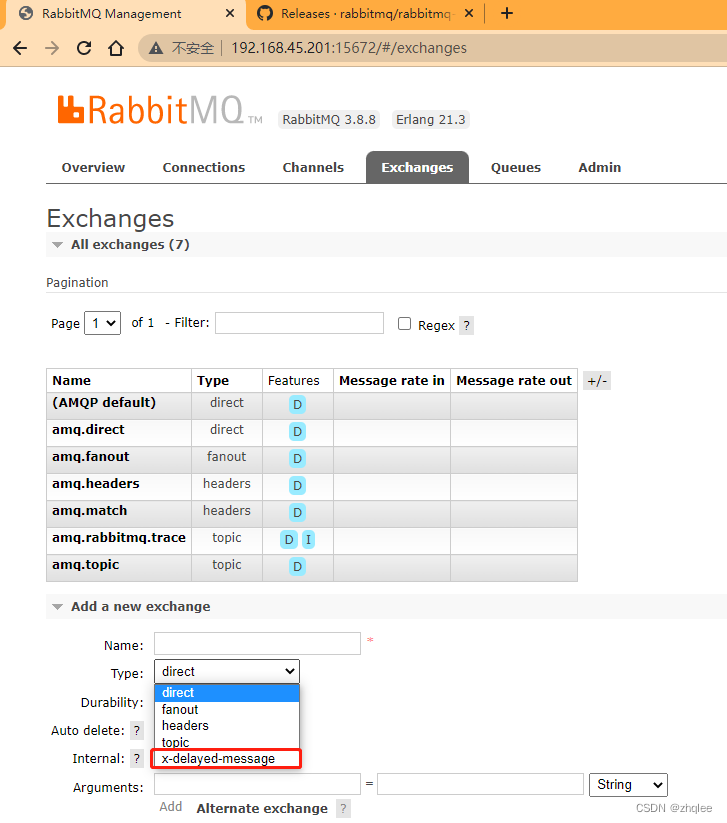
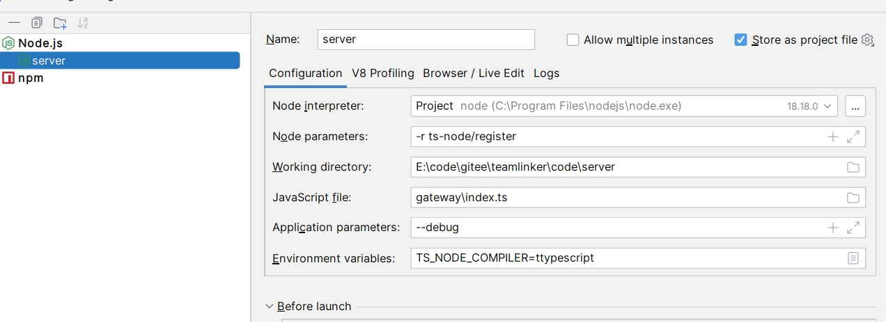

## 📝本地部署

如果您想本地部署

首先您需要安装的软件环境有：
* Redis 推荐版本5.0+
* Rabbitmq 推荐版本3.12+,
* Mysql 推荐版本5.7+
* Nodejs 推荐版本18+ 
* Vue 推荐版本3.0+ 

🚧 注意：Rabbitmq需要安装消息延迟队列插件

### 消息延迟队列插件安装
1、下载

官网下载地址： https://www.rabbitmq.com/community-plugins.html

我们也提供了下载  [消息延迟队列插件包](./file/rabbitmq_delayed_message_exchange-3.12.0.ez)

🚧 注意：要选择对应的版本

2、添加至 `plgins` 目录中

比如我们放在这个目录
```bash
/usr/lib/rabbitmq/lib/rabbitmq_server-3.12.0/plugins
```

3、安装
```bash
cd /usr/lib/rabbitmq/lib/rabbitmq_server-3.12.0/plugins
rabbitmq-plugins enable rabbitmq_delayed_message_exchange
systemctl restart rabbitmq-server
```
再次登录rabbitmq，如果exchange的类型中出现：`x-delayed-message`，说明该插件安装成功！



### 服务端配置文件
下面来给大家介绍下配置文件：

配置文件位置 `code/server/teamlinker.config.json` 

如果该文件不存在，就创建并用下面的模板内容填充

```json
{
    "redis":{
        "url":"localhost",
        "port":6379,
        "db":0,
        "password":""
    },
    "mysql":{
        "url":"localhost",
        "port":3306,
        "database":"",
        "username":"",
        "password":""
    },
    "port":14000,
    "jwt": "teamlinker",
    "version":"最新的版本号",
    "mq": "amqp://127.0.0.1",
    "mail":{
        "host": "",
        "port": 465,
        "user":"",
        "pass":""
    },
    "wechat":{
        "appId":"",
        "appSecret":""
    }
}
```
你需要用你自己的值去填充这个配置文件

### 安装依赖
1、先切换到 `teamlinker` 项目根目录


然后安装依赖
```
npm install
```

### 服务端部署

2、先切换到 `code/server` 目录

然后安装依赖
```
npm install
```
启动后端


### 客户端部署
3、先切换到 `code/client` 目录

然后安装依赖
```
npm install
```
启动服务
```
npm run dev 
```
🚧 注意: 端口修改  `code/client/vite.config.ts` `port` 配置项 默认`3000`

